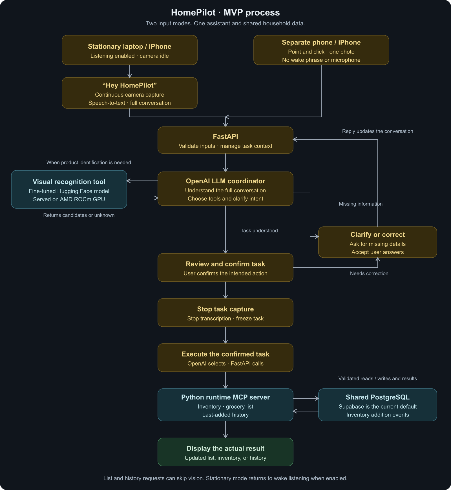

# HomePilot

HomePilot is a software-first grocery assistant for a four-person hackathon team. The planned MVP lets someone enable listening on a stationary laptop or iPhone, say **"Hey HomePilot"**, and describe a task while the webcam captures continuously and speech is transcribed. Once HomePilot understands the task and the user confirms it, task capture and transcription stop and execution begins. The user can identify groceries, save confirmed items to inventory, and manage a grocery list. A separate phone/iPhone can also take one photo per tap without voice activation; both modes share the same household data. The full active conversation is used to understand requests, including list/history questions that need no image recognition. Typed input remains available. The planned computer vision service runs on the team's AMD ROCm GPU; Supabase stores inventory and list data. The planned OpenAI LLM coordinator uses a fine-tuned dedicated vision model as a recognition tool and a separate Python runtime MCP server for household actions. This separates visual evidence from reasoning so recognition can be trained, evaluated, and improved independently. See [recognition design and judging rationale](docs/RECOGNITION_DESIGN.md).

**Current state:** this repository is a project foundation, not a working end-to-end app. The web page supports webcam preview, single-frame JPEG capture, and image-file selection. The revised MVP includes stationary voice on laptop/iPhone and separate mobile point-and-click; these integrations are still pending. The API and vision service expose health checks and return `501 Not Implemented` for planned operations. The runtime MCP process has no tools yet. Wake-phrase detection, speech-to-text, continuous task capture, and session confirmation are not implemented. No model, LLM provider, recognition coordinator, Supabase project, or deployment is connected.

## MVP process

The diagram shows the planned MVP. Both input modes use the same household data; the integrations are still under development.



[Open full-size diagram](docs/assets/homepilot-process.png) · [Editable SVG](docs/assets/homepilot-process.svg) · [Mermaid source](docs/assets/homepilot-process.mmd)

Requests such as **"add milk to the list," "show me the grocery list,"** and **"when did we last get rice?"** can use MCP without product recognition. "Last got" means the last recorded addition to inventory. After a stationary task finishes, the device returns to wake listening if it remains enabled. Developer GitHub MCP is a separate connection used by coding agents.

## Read first

1. [MVP scope](docs/MVP_SCOPE.md) and [product brief](docs/PRODUCT.md)
2. [Architecture](docs/ARCHITECTURE.md), [voice and capture lifecycle](docs/VOICE_CAPTURE.md), and [API contracts](docs/API_CONTRACTS.md)
3. [Team ownership](docs/TEAM.md) and [decisions](docs/DECISIONS.md)
4. [Agent instructions](AGENTS.md) for Codex and other agents; Claude Code also reads [CLAUDE.md](CLAUDE.md)

The API source of truth is [contracts/openapi.yaml](contracts/openapi.yaml). The database starter migration is [supabase/migrations/0001_initial.sql](supabase/migrations/0001_initial.sql).

The [decision log](docs/DECISIONS.md) distinguishes your confirmed requirements from starter proposals awaiting team review. The private single-household demo and stdio MCP transport are proposed defaults. Supabase is the current database default while the team considers other PostgreSQL hosting options.

## Repository map

| Path | Purpose | Initial owner |
| --- | --- | --- |
| `apps/web` | Desktop wake-phrase, microphone, continuous webcam, transcript and confirmation UI; both iPhone modes are P0 | Developer 4, frontend |
| `services/api` | FastAPI client API, validation, orchestration, Supabase access | Developer 2, backend |
| `services/vision` | ROCm model inference API and evaluation work | Developer 1, ML |
| `services/runtime_mcp` | Python MCP tools used by the HomePilot agent | Developer 3, agent |
| `contracts` | Shared API schema and sample payloads | Developer 2, with all consumers reviewing |
| `supabase` | SQL migrations | Developer 2, with Developer 3 reviewing tool needs |
| `docs` | Shared product and technical decisions | All four |

## Local setup for the starter

Prerequisites: Node.js/npm, Python 3.11+, and Docker only if you choose the optional local GitHub MCP route. Use team-approved runtime versions when implementing integrations; [TECH_STACK.md](docs/TECH_STACK.md) records choices still open.

```bash
cd apps/web
npm ci
npm run dev
```

Open `http://localhost:3000` on your computer. Click **Start webcam**, allow camera access, hold up an item, and click **Capture photo**. Use **Stop webcam** when finished, or select an image file as a fallback. A built-in camera or USB webcam (including a Brio attached to the development computer) can be used; choose the intended device through your browser camera settings. The starter only captures and previews locally. Browser webcam access requires localhost or HTTPS; see [MDN camera access guidance](https://developer.mozilla.org/en-US/docs/Web/API/MediaDevices/getUserMedia). For P0, test both iPhone modes from an HTTPS URL the phone can reach; stationary voice requires the app visible and listening enabled. Mobile capture does not require microphone permission.

In another terminal:

```bash
cd services/api
python3 -m venv .venv
source .venv/bin/activate
pip install -r requirements.txt
uvicorn app.main:app --reload --port 8000
```

Check `http://localhost:8000/health`. The generated `/docs` page shows only starter routes; use `contracts/openapi.yaml` for the intended API. Planned routes return 501 until their assigned developer implements them. The separate vision stub can be started from `services/vision` with its own `requirements.txt` and `uvicorn app.main:app --reload --port 8001`.

Secrets go in local, ignored `.env` files or each developer's secret manager. The sample [`.env.example`](.env.example) lists server-side settings only. **Never expose the Supabase service role key or an LLM key to the browser.** The repository does not load these settings yet.

## Day one: four parallel tracks

1. As a team, assign the four owners in [TEAM.md](docs/TEAM.md), create a private GitHub repository, protect `main`, and agree on one demo household and a small recognition test set. After applying the SQL migration in a disposable Supabase project, create the demo household with `insert into public.households (name) values ('Hackathon demo') returning id;` and keep the returned ID in server-side configuration. Use issues and PRs for changes to shared contracts.
2. Developer 2 coordinates the contract and migration PR. The new P0 voice-session contract must define transcript/frame correlation, clarification, task confirmation, cancellation, limits, and execution deduplication; current OpenAPI only covers image/text requests. All four review this before integrating clients.
3. Developer 1 verifies AMD GPU/ROCm/PyTorch, implements baseline inference, then fine-tunes and evaluates the vision checkpoint for P0. Record dataset splits, checkpoint/version, latency, and unknown results.
4. Developer 3 implements OpenAI orchestration, full active-conversation context, task interpretation/clarification, bounded recognition coordination with Developers 1 and 2, and runtime MCP inventory/list tools. With Developer 4, select and verify wake detection and speech-to-text on the actual demo browser; record providers and audio processing location. Evaluate coordination against Developer 1's direct vision baseline on the same held-out images. Start with in-memory fixtures while the database contract is reviewed, then replace them with the approved Supabase access path.
5. Developer 4 builds Enable listening, "Hey HomePilot" activation, continuous camera capture with bounded frame sampling, live transcription, clarification/confirmation, and Stop controls. Retain manual capture and typed fallbacks. Connect the reviewed session contract and inventory/list/chat views as backend routes land.
6. Establish the image-recognition and text/MCP baselines, then integrate wake activation → continuous frames and transcription → clarify → understand and confirm task → stop task capture/transcription → execute once → show actual result. The voice flow is required before P0 passes. Rehearse it from a desktop webcam/microphone, complete stationary laptop/iPhone and separate mobile capture within P0. Add reviewed MCP addition/history tools and event persistence for "when did we last get rice?"; report the last inventory addition, not a purchase date.

Each person can use Codex, Claude Code, Cursor, or another coding agent. Agents should read repository docs and the assigned issue on each task; [GitHub MCP setup](docs/DEVELOPMENT_MCP.md) provides live GitHub context but does not synchronize local files or agent memory.

## Working agreement

- Create an issue with owner, acceptance criteria, and dependencies before substantial work.
- Use short-lived branches and PRs. Schema, migration, security boundary, or endpoint changes require review from affected owners.
- Update `contracts/openapi.yaml`, examples, and relevant docs in the same PR as a contract change.
- Run the checks relevant to changed code. For the starter, `python3 -m compileall services` and `python3 -m json.tool contracts/examples/recognition-unknown.json` are dependency-free checks; see [validation](docs/TEAM.md#review-and-validation).
- A 501 response is an explicit unfinished endpoint, not a successful integration.

## After MVP

Only after the complete software workflow is stable should the team prioritize the Raspberry Pi Zero 2 W, its Logitech Brio integration, KLYSTR SPI LCD, audio, and 3D printed enclosure. These robot components are listed in [MVP_SCOPE.md](docs/MVP_SCOPE.md) as post-MVP work and have no current service dependency. Using a webcam and microphone on a development computer, including wake activation and speech-to-text, is required initial software work. Robot audio integration remains post-MVP.
