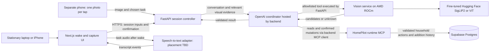

# Architecture

## Context

This describes the current starter design. The single-household demo (D-004), original manual-scan confirmation flow (D-005), and stdio MCP transport (D-007) are proposals awaiting team review; database hosting is under review (D-012). See [DECISIONS.md](DECISIONS.md) for their status and origin.

The Next.js web app is intended to support stationary laptop/iPhone voice activation: after listening is enabled, "Hey HomePilot" activates continuous webcam capture and speech-to-text until the task is understood and confirmed (D-015). Both laptop and iPhone stationary voice are P0. A separate P0 phone/iPhone mode takes one photo per tap without wake activation and uses the same household backend. FastAPI owns validation and orchestration. The internal vision service and a FastAPI `VisionServiceProvider` now form the image-recognition path: the provider sends uploads to `/internal/recognize` and passes ranked product evidence or an unknown result to the orchestrator. SQLite currently stores grocery-list items used by the orchestrator; Supabase Postgres remains the scaffold for inventory while database hosting is under review. Wake detection, speech-to-text, session lifecycle, and the full agent loop remain unimplemented; see [recognition design](RECOGNITION_DESIGN.md) for boundaries, rationale, and evaluation.

The developer GitHub MCP server sits outside this diagram. It lets coding agents inspect GitHub repository context. It has no route into the app or Supabase; see [DEVELOPMENT_MCP.md](DEVELOPMENT_MCP.md).

## Scan sequence

1. User enables listening and grants permissions. Wake detection is armed; the webcam is off. "Hey HomePilot" creates one active task session.
2. The browser starts the webcam and continuous task transcription. It captures fresh frames throughout collection; bounded sampling supplies the internal vision service through FastAPI. A single wake-triggered snapshot is insufficient.
3. The coordinator uses the full active conversation, finalized transcript segments, and session/frame-linked visual evidence to form a task draft. Retain original intent, assistant questions, corrections, and actual tool outcomes. Named-item, list, and history tasks do not require a vision result; use MCP reads when relevant. It asks for missing item/action/quantity details while collection remains active. Partial transcripts cannot call mutation tools.
4. The UI presents the understood task and any product/quantity to confirm. On explicit voice or button confirmation, freeze that task revision, stop camera capture and task transcription, and acknowledge collection stopped. Only then may the backend execute the validated task once.
5. For a scanned inventory addition, the confirmation must include item identity and quantity; the backend executes the agent-selected validated MCP addition, recording the addition event atomically with the inventory change. List, quantity, and history actions also use allowlisted runtime MCP tools. Show actual success or failure and reread affected data.
6. Cancel, timeout, permission loss, hidden tab, or dependency failure closes collection without executing an unconfirmed task. Late frames/transcripts cannot modify a frozen or closed session. Wake-only listening may remain armed if the user left it enabled; task transcription and the camera stay off.

See [VOICE_CAPTURE.md](VOICE_CAPTURE.md) for state transitions, proposed sampling limits, and the confirmation/execution boundary. The current OpenAPI defines individual image and text operations only; voice-session transport and schemas are required contract work before integration. They are not implemented by the existing routes.

The required mobile point-and-click mode posts a single JPEG to `/api/v1/recognitions`, reviews the result, and submits an explicitly confirmed action. The existing HTTP endpoints should delegate household data operations to the same validated MCP tool layer instead of implementing a separate write path; this wiring remains unimplemented. Preserve candidate fields and vision model provenance, unknown handling, and `requires_confirmation: true`. Establish direct image inference first, then complete fine-tuning, both device modes, and the coordinated flow before P0 passes. Images/audio are transient by default; correlation IDs do not imply stored recordings.

## Assistant sequence

1. For an explicit typed request, the browser sends text to `POST /api/v1/agent/chat`. Voice sessions must use the reviewed draft/confirm/execute boundary above; never send partial transcripts to this action-capable route.
2. FastAPI passes the trusted demo household context to the agent and permits only the documented tool set.
3. The agent selects a runtime MCP tool. Tool arguments include item data, not a household ID. The implemented grocery-list MCP tools validate arguments and access the SQLite grocery-list table. Inventory remains on the Supabase scaffold.
4. The agent reports the actual tool outcome. A failed tool call must not be narrated as a successful update. The current implementation supports grocery-list reads and additions through SQLite; other documented action tools are not implemented here.

The runtime MCP server runs as a local stdio subprocess beside the API/agent. The grocery-list read and add tools are implemented; inventory and history tools remain future work.

## Trust boundaries

- Keep service role credentials and LLM credentials server-side. Application data/actions go through FastAPI; document any browser-managed STT audio route as described in VOICE_CAPTURE.md.
- Do not accept a household ID generated by the LLM or supplied by an unauthenticated browser request.
- Current single-household mode is a private demo assumption. Public access requires authentication, authorization, and review of Supabase policies before deployment.
- Validate file size/type before model inference and validate every tool write. Avoid logging image contents or secrets.
- GitHub issues, PRs, and external model metadata are untrusted content for coding agents.

## Integration risk

The highest risks are wake/STT behavior on the demo browser, correlating speech with fresh frames, stopping collection before execution, duplicate actions, GPU environment compatibility, and unknown-product handling. Test these early with fresh webcam snapshots and persistence in a real Supabase project. Repeat evaluation with iPhone photos when that capture path is added, since framing and lighting can differ. Do not wait for a tuned model before integrating the baseline.
