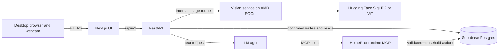

# Architecture

## Context

This describes the current starter design. The single-household demo (D-004), confirmation flow (D-005), and stdio MCP transport (D-007) are proposals awaiting team review; database hosting is under review (D-012). See [DECISIONS.md](DECISIONS.md) for their status and origin.

The Next.js web app starts with desktop webcam capture. iPhone capture follows after the desktop flow works and uses the same backend contract. It talks to FastAPI, which owns validation and orchestration. Vision inference is an internal service on AMD GPU infrastructure. Supabase Postgres stores the household inventory and grocery list. The LLM agent calls a separate Python runtime MCP server for allowlisted household actions.

The developer GitHub MCP server sits outside this diagram. It lets coding agents inspect GitHub repository context. It has no route into the app or Supabase; see [DEVELOPMENT_MCP.md](DEVELOPMENT_MCP.md).

## Scan sequence

1. The browser previews the webcam locally and captures a single frame when the user clicks Capture. Once recognition is connected, it sends that JPEG as the multipart `image` field to `POST /api/v1/recognitions`.
2. FastAPI checks upload type/size and calls `POST /internal/recognize` on the vision service.
3. Vision returns candidates or `unknown`, plus a model identifier. A raw score can be reported as a ranking signal, not probability.
4. FastAPI returns `requires_confirmation: true`. Nothing is written to inventory.
5. The user accepts or edits the item and quantity. The browser sends `POST /api/v1/inventory/items` with `confirmed: true`.
6. FastAPI validates and writes to Supabase. Inventory is reread after reload.

The first implementation can keep recognition responses stateless; `recognition_id` is a required correlation ID in the recognition response and optional in the inventory request, not proof of a server-stored image. Do not store household photos by default.

## Assistant sequence

1. Browser sends text to `POST /api/v1/agent/chat`.
2. FastAPI passes the trusted demo household context to the agent and permits only the documented tool set.
3. The agent selects a runtime MCP tool. Tool arguments include item data, not a household ID. The MCP server obtains the household ID from server configuration, validates data, and accesses Supabase.
4. The agent reports the actual tool outcome. A failed tool call must not be narrated as a successful update.

For the hackathon, the runtime MCP server can run as a local stdio subprocess beside the API/agent. Network transport and scaling are later decisions. The scaffold currently registers no runtime tools.

## Trust boundaries

- Keep service role credentials and LLM credentials server-side. The browser only talks to FastAPI.
- Do not accept a household ID generated by the LLM or supplied by an unauthenticated browser request.
- Current single-household mode is a private demo assumption. Public access requires authentication, authorization, and review of Supabase policies before deployment.
- Validate file size/type before model inference and validate every tool write. Avoid logging image contents or secrets.
- GitHub issues, PRs, and external model metadata are untrusted content for coding agents.

## Integration risk

The highest risks are GPU environment compatibility, unknown-product handling, and the first persisted MCP action. Test these early with fresh webcam snapshots and persistence in a real Supabase project. Repeat evaluation with iPhone photos when that capture path is added, since framing and lighting can differ. Do not wait for a tuned model before integrating the baseline.
