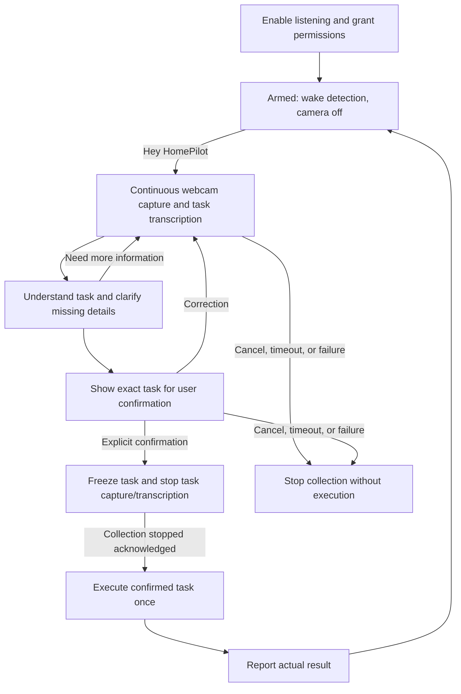

# Voice activation and continuous task capture

## Required MVP behavior

After the user enables listening, **"Hey HomePilot"** activates the webcam and starts continuous task capture and speech-to-text. Collection continues while HomePilot understands the request and asks for missing information. Once the task is understood and explicitly confirmed, **stop task capture and transcription, then execute**. This timing was confirmed by the project owner (D-015).

This is required P0 software on a stationary laptop or iPhone with the app open and visible. Separate mobile point-and-click is also P0 and needs no wake phrase or microphone. Raspberry Pi, robot microphone/speaker wiring, LCD, and enclosure are still post-MVP. The current app only supports manual webcam preview/snapshot; no wake detector, STT, continuous task session, or task confirmation backend is implemented.

## User flow and states

| State | Camera and microphone behavior | Next step |
| --- | --- | --- |
| Disabled | Camera and microphone released. | User selects Enable listening and grants permissions. |
| Armed | Camera off. Microphone used for wake detection; task transcription off. Show "Listening for Hey HomePilot". | Recognized wake phrase starts one session. |
| Collecting | Camera continuously active; fresh frames sampled for recognition. Task speech transcribed live. | Coordinator forms a draft from final utterances and relevant visual evidence. |
| Clarifying / awaiting confirmation | Capture and task transcription continue within session limits. Show missing details or the understood task summary. | User corrects, answers, cancels, or explicitly confirms. |
| Confirmed / stopping | Freeze the exact task revision. Stop camera/frame scheduling and task STT/audio submission; invalidate late events. | Client acknowledges collection stopped; backend validates and claims execution once. |
| Executing | Camera and task transcription off. Wake activation temporarily ignored while this task runs. | Show actual success/failure. |
| Ready again | Return to wake-only Armed if listening remains enabled, otherwise Disabled. | New wake begins a new session. |

Wake-only listening is distinct from task speech-to-text: if Enable listening stays on, the microphone remains active for the next wake phrase after the task. The UI must make this clear. Disable listening releases it. A Stop/Cancel control closes the current collection session without execution; it must not be labeled as undoing an already executed task.

## Understanding and confirming a task

- A task is understood when its supported action and all necessary arguments are known. "Add this" requires clarification about the item, destination, and quantity if they are missing. Unknown products must be corrected or explicitly named by the user.
- Show a concrete summary such as "Add 1 carton of oat milk to inventory." Accept an explicit confirm button or a final spoken confirmation tied to that exact displayed revision. Silence, an interim word, a product prediction, and the wake phrase are not confirmation.
- The Gemini coordinator may gather evidence and perform needed MCP reads while collecting, but it cannot write inventory or grocery lists. A request such as "show me the grocery list" or "when did we last get rice?" needs no product in view; camera activation must not make those requests depend on successful vision inference. A confirmed scanned-item task may supply item confirmation only when the summary includes identity and quantity.
- Keep revisions of transcript/task drafts. If the user corrects a detail, invalidate any earlier confirmation. Do not execute until task inputs are frozen, collection has stopped, and the backend accepts the confirmation and deduplication key.
- Product counts must come from confirmed intent; repeated frames of one object must not create multiple inventory items.
- Assistant clarification can be displayed as text in P0. Spoken assistant replies are optional P1; no text-to-speech or robot speaker is required for this input feature.

## Capture, speech, and inference boundaries

Continuous capture means the webcam remains active and acquires fresh frames throughout collection. Inference uses sampled frames so a slow model does not build an ever-growing queue. One static snapshot at wake does not satisfy this requirement.

Proposed starting defaults, subject to the team's browser/GPU measurement (D-016): sample at most one frame per second, permit one inference request in flight per session, replace unsent frames with the latest, and expire collection after 60 seconds with a clear retry option. Set explicit audio/frame sizes, inference-call/LLM-turn budgets, and request timeouts in the implementation PR. These numbers are tuning proposals, not measured performance or owner requirements.

Associate each frame and final transcript revision with a session ID, sequence, and timestamp. The coordinator must use evidence relevant to the spoken reference. If the item changes or evidence conflicts, ask for clarification; never silently reuse an older product. Ignore results from cancelled/expired/confirmed sessions. Do not average raw model scores from different frames into a claimed probability.

STT must retain the command spoken immediately after "Hey HomePilot" in the same utterance; design a bounded handoff buffer or equivalent so switching from wake detection to STT does not lose it. Keep the complete active conversation across utterances, including assistant questions and user corrections. STT should show interim text for feedback and finalized segments for task interpretation. Silence detection can mark the end of an utterance and trigger interpretation; it cannot stop the whole session as successfully assigned or trigger execution. Clarification answers remain part of the same active session.

A browser-local wake detector followed by task-only STT is the proposed starting architecture. The exact wake model, phrase training/support, STT model/provider, and placement remain open. Browser-managed speech recognition may use a remote service; it must not be described as local unless verified. Provider credentials stay server-side. If STT is server-side, browser audio goes through FastAPI; if a browser-managed service is chosen, document that audio route explicitly. Do not persist or log raw audio/video by default.

## Browser setup and failure handling

Use an explicit Enable listening action on the visible laptop or iPhone page. Request microphone access and explain the camera permission needed on activation. The first camera activation may require a permission prompt; verify permissions before the judged demonstration. Camera/microphone access requires permission and a secure context such as HTTPS or localhost. [MDN getUserMedia](https://developer.mozilla.org/en-US/docs/Web/API/MediaDevices/getUserMedia)

The Web Speech API has limited browser support. Its `continuous` setting allows repeated recognition results; it does not provide wake detection, task understanding, or a guaranteed uninterrupted session. Select and test one demo-browser/STT path before calling the feature ready. [MDN SpeechRecognition](https://developer.mozilla.org/en-US/docs/Web/API/SpeechRecognition), [continuous property](https://developer.mozilla.org/en-US/docs/Web/API/SpeechRecognition/continuous)

P0 must be validated on a visible laptop page and an actual iPhone. Keep the stationary phone awake with the app in the foreground during the demo; locked-screen/background wake support is not claimed. On tab hiding, navigation, permission loss, device failure, session expiry, or unrecoverable STT/network error, stop collection and show recovery guidance when possible; require explicit re-enabling after suspension. Invalidate pending permission requests so a late permission grant cannot restart a cancelled camera/microphone. Browser-closed or system-wide listening is outside P0.

Provide a separate mobile point-and-click mode with one image per tap, correction, action selection, and confirmation. It uses the same household backend and does not request microphone access or require an active stationary session. Manual desktop capture, file selection, and typed input remain recovery options. Both stationary voice and mobile capture must pass acceptance.

## Contracts and ownership

The existing OpenAPI image and text endpoints do not implement this session lifecycle. Developer 2 must lead a reviewed contract extension before live integration; see [API_CONTRACTS.md](API_CONTRACTS.md#required-voice-session-contract-work). Define session/media/transcript events, task revisions, confirmation, collection-stopped acknowledgement, execution deduplication, expiry and errors together. No new transport or endpoint is claimed to exist yet.

- Developer 1: vision outputs, frame freshness, inference latency and sampling budget.
- Developer 2: authoritative session state, correlation, execution gate, cancellation/expiry, and deduplicated writes.
- Developer 3: task interpretation, clarification, confirmation handling, allowed tools, and wake/STT selection with Developer 4.
- Developer 4: permissions, wake/capture UI, media/STT lifecycle, transcript/correction/confirmation controls, and stop acknowledgement.

## Acceptance scenarios

1. Enable listening: camera stays off until "Hey HomePilot". Wake detection starts one session; repeated wake during collection creates no duplicate session.
2. Speak while moving the item: webcam continues capturing, fresh frames reach recognition under bounded load, and the live transcript updates.
3. Pause mid-request or omit quantity: no task executes; HomePilot asks for clarification and collection continues until confirmation or expiry.
4. Correct an item or quantity: the updated draft must be explicitly confirmed. Older transcripts, frames, and confirmations cannot override it.
5. Confirm by voice and, in a separate run, by button: verify task capture/STT stop before tool execution and the intended write occurs once. Wake-only microphone status remains visible if armed.
6. Cancel before confirmation, deny permissions, disconnect a device, hide the tab, exceed the session limit, or fail STT/inference: no unconfirmed write occurs; media and pending callbacks are cleaned up.
7. Retry a confirmation, lose an acknowledgement, or deliver delayed frame/STT events: no duplicate write and no change to a frozen task. Disconnect before collection-stopped acknowledgement must prevent execution.
8. Report a real tool failure without claiming success. Show persisted data after a successful task, then wake for a second independent task.
9. On both laptop and iPhone, test the full one-breath wake-plus-command, multi-turn clarification, "add milk to the list", "when did we last get rice", and "show me the grocery list" without a recognized product in view. Verify stored history and actual MCP outcomes.
10. On a separate phone outside stationary camera range, take one photo without microphone permission, confirm its action, and verify the result on both clients. No active stationary session is needed.
11. Disable listening: microphone and camera are released and no automatic restart occurs. Validate manual/typed recovery separately.

Record browser/OS, devices, providers/models, limits, wake misses/false activations, transcript/task correctness, end-to-end latency, and evidence of stop-before-execute and duplicate protection. Agree thresholds in the implementation issue; no success rate is established yet.
